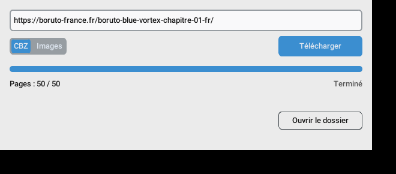

# Offreader

Outil en ligne de commande qui ouvre un lecteur web dans Chromium, repère les
planches d'un chapitre, les télécharge **dans leur ordre exact de lecture** et
les exporte dans un dossier d'images ou une archive **CBZ**.

Aucune configuration n'est nécessaire pour chaque site : deux stratégies
génériques couvrent les lecteurs les plus courants.

| Type de lecteur | Fonctionnement |
|---|---|
| **Défilement vertical** (toutes les planches dans la page) | défilement progressif pour déclencher le lazy loading, tri des images par structure DOM, position et dimensions, déduplication |
| **Page par page** (une planche à la fois) | repérage de l'image principale, puis navigation automatique : bouton « suivant », touches ← / →, clic sur l'image, numéro de page dans l'URL, liste déroulante des pages |

## Version en ligne (navigateur web)

Offreader peut aussi tourner sur un serveur : on l'utilise alors depuis
n'importe quel navigateur (PC, Mac, téléphone), sans rien installer.

Collez **un ou plusieurs liens** (un par ligne), choisissez **CBZ** ou
**Images (ZIP)**, cliquez sur **Télécharger**. Chaque lien apparaît dans la
liste avec sa progression ; **Enregistrer** récupère le fichier, **Tout
télécharger (ZIP)** regroupe tous les chapitres terminés, **Reprendre** relance
un chapitre annulé ou incomplet là où il s'était arrêté.

### Héberger sur Render (gratuit, quelques clics)

1. Créer un compte sur <https://render.com> et le relier à GitHub.
2. **New +** → **Blueprint** → choisir ce dépôt (le fichier `render.yaml` est lu
   automatiquement).
3. Saisir un mot de passe pour **`OFFREADER_PASSWORD`**, puis **Apply**.

Après la construction (5 à 10 minutes la première fois), le site est en ligne à
une adresse du type `https://offreader-xxxx.onrender.com`. Le navigateur demande
le mot de passe (le nom d'utilisateur est libre).

> Offre gratuite de Render : le service s'endort après 15 minutes sans visite
> (le premier chargement suivant prend environ une minute), 512 Mo de mémoire
> (un chapitre traité à la fois, les autres attendent dans la file), et les
> fichiers produits disparaissent au redémarrage : enregistrez vos CBZ dès
> qu'ils sont prêts.

### Héberger ailleurs (Docker)

Le `Dockerfile` fonctionne sur tout hébergeur de conteneurs (Fly.io, Railway,
Koyeb, un VPS…) :

```sh
docker build -t offreader-web .
docker run -p 8000:8000 -e OFFREADER_PASSWORD=monmotdepasse -v offreader-data:/data offreader-web
```

puis ouvrir <http://localhost:8000>.

| Variable | Rôle | Défaut |
|---|---|---|
| `OFFREADER_PASSWORD` | mot de passe du site (**à définir** dès que le site est public) | aucun |
| `OFFREADER_MAX_PARALLEL` | chapitres traités en même temps (un Chromium chacun) | 2 |
| `OFFREADER_RETENTION_HOURS` | durée de conservation des fichiers sur le serveur | 24 |
| `OFFREADER_MAX_URLS` | liens acceptés par envoi | 50 |
| `OFFREADER_DATA_DIR` | dossier des fichiers produits | `/data` (Docker) |
| `PORT` | port d'écoute | 8000 |

Sans Docker : `pip install -r requirements-web.txt`, `playwright install chromium`,
puis `python -m offreader.web`.

> Certains sites bloquent les adresses IP des hébergeurs (centres de données) :
> si un lien fonctionne dans l'application Windows mais pas en ligne, c'est
> probablement la raison.

## Application Windows



Collez l'URL du chapitre (ou plusieurs, une par ligne : elles sont traitées
l'une après l'autre), choisissez **CBZ** ou **Images**, cliquez sur
**Télécharger** (ou Ctrl+Entrée). À la fin, **Ouvrir le dossier** affiche le fichier dans
l'Explorateur. Le bouton devient **Annuler** pendant le travail ; un
téléchargement annulé ou incomplet reprend là où il s'était arrêté.

Le fichier est enregistré dans **`Téléchargements`** (`%USERPROFILE%\Downloads`),
sous le titre de la page, par exemple :
`Téléchargements\Boruto Blue Vortex - chapitre 01 FR - Boruto - France.cbz`.

### Option 1 — Lanceur `Offreader.bat` (le plus simple)

1. Installer **Python 3.12 ou plus récent** depuis <https://www.python.org/downloads/>
   en cochant **« Add python.exe to PATH »**.
2. Double-cliquer sur **`Offreader.bat`**.

Le premier lancement prépare tout (environnement `.venv`, dépendances,
Chromium) : quelques minutes, une fenêtre de console affiche l'avancement.
Les lancements suivants ouvrent directement l'application.

### Option 2 — Exécutable autonome `Offreader.exe`

Sur un poste Windows avec Python 3.12+, double-cliquer sur **`build_exe.bat`**.
Il produit `dist\Offreader\Offreader.exe` avec Python, Playwright et Chromium
embarqués (dossier d'environ 400 Mo). Ce dossier peut ensuite être copié sur
un autre PC Windows **sans Python** : lancer `Offreader.exe`. Copier tout le
dossier `dist\Offreader`, pas seulement le `.exe`.

### Navigateur

L'application cherche dans l'ordre : le Chromium de Playwright (embarqué ou
installé), puis **Microsoft Edge** (présent sur tout Windows 11), puis Google
Chrome ; à défaut, elle télécharge Chromium automatiquement au premier usage.

### En cas de problème

Les erreurs s'affichent en rouge sous la barre de progression. Le journal
détaillé est dans `%LOCALAPPDATA%\Offreader\offreader.log`.

## Installation en ligne de commande (Windows 11)

1. Installer **Python 3.12 ou plus récent** depuis <https://www.python.org/downloads/>
   (cocher « Add python.exe to PATH » pendant l'installation).
2. Ouvrir un terminal (PowerShell) dans le dossier du projet, puis :

```powershell
py -m venv .venv
.venv\Scripts\Activate.ps1
pip install -r requirements-gui.txt
playwright install chromium
python offreader_gui.pyw          # application graphique
```

> Si PowerShell refuse d'exécuter `Activate.ps1`, lancer une fois
> `Set-ExecutionPolicy -Scope CurrentUser RemoteSigned`, ou utiliser
> `.venv\Scripts\activate.bat` depuis l'invite de commandes (cmd).

## Utilisation

```powershell
python manga_downloader.py "URL_DU_CHAPITRE" --format cbz
```

Plusieurs chapitres d'un coup : donner plusieurs URL, ou un fichier texte
contenant une URL par ligne :

```powershell
python manga_downloader.py "URL_1" "URL_2" "URL_3"
python manga_downloader.py --file liens.txt
```

Le fichier `Nom_du_chapitre.cbz` est créé dans `Téléchargements` (`%USERPROFILE%\Downloads`).
Le nom vient du titre de la page ; `--name` permet de le choisir.

```
Analyse du lecteur...
Mode détecté : page par page
Pages récupérées : 20 / 20
Planches détectées (dernière page atteinte (20)) : 20 / 20
Téléchargement : 100 % (20/20)
Export CBZ...
Terminé : 20 planches -> C:\Users\moi\Downloads\Mon chapitre.cbz
```

### Options

| Option | Rôle | Défaut |
|---|---|---|
| `--format cbz\|images` | archive CBZ, ou dossier `001.webp`, `002.jpg`… | `cbz` |
| `--output DOSSIER` | dossier de destination | `~\Downloads` |
| `--file FICHIER` | fichier texte : une URL par ligne (s'ajoute aux URL données) | — |
| `--name NOM` | nom du chapitre (fichier ou dossier), avec un seul lien | titre de la page |
| `--headless` / `--no-headless` | masquer / afficher Chromium | masqué |
| `--mode auto\|vertical\|paged` | imposer le type de lecteur | `auto` |
| `--max-pages N` | nombre maximal de pages en mode page par page | 500 |
| `--timeout S` | délai maximal d'un chargement ou d'un téléchargement (s) | 30 |
| `--retries N` | nouvelles tentatives par image en cas d'erreur | 4 |
| `--workers N` | téléchargements simultanés | 4 |
| `--verbose`, `-v` | journal détaillé (choix de la stratégie, erreurs, essais) | — |

`--no-headless` est utile pour observer le lecteur, ou quand le site demande
une action manuelle (bandeau de cookies, vérification) : la fenêtre reste
pilotable pendant l'analyse.

### Codes de sortie

| Code | Signification |
|---|---|
| 0 | toutes les planches ont été récupérées et exportées |
| 1 | erreur (page inaccessible, aucune planche trouvée, Chromium absent…) |
| 2 | chapitre incomplet : au moins une planche n'a pas pu être téléchargée, ou le lecteur annonce plus de pages que trouvées. **Aucun CBZ n'est créé** ; les planches obtenues sont conservées et la même commande reprend là où elle s'est arrêtée |
| 130 | interruption (Ctrl+C) ; relancer pour reprendre |

Avec plusieurs liens, tous sont traités même si l'un échoue ; le code de
sortie est le plus grave rencontré et un bilan s'affiche à la fin.

## Fiabilité

- **Ordre garanti** : chaque planche reçoit son numéro avant le téléchargement ;
  le nom du fichier (`001`, `002`…) ne dépend pas de l'ordre de fin des
  téléchargements parallèles.
- **Fichiers d'origine** : aucune conversion ; l'extension correspond au format
  réel détecté (`.webp`, `.jpg`, `.png`, `.avif`…). Le CBZ est créé sans
  compression (`ZIP_STORED`) puis relu et vérifié.
- **Intégrité** : taille annoncée par le serveur, décodage complet par Pillow
  (fichiers tronqués, pages d'erreur HTML refusés). Écriture atomique
  (`.part` puis renommage).
- **Erreurs temporaires** (délai, connexion coupée, HTTP 429/5xx, fichier
  tronqué) : nouvel essai avec délai progressif (0,5 s, 1 s, 2 s…).
- **Reprise** : un manifeste `.offreader.json` mémorise l'URL et l'empreinte
  SHA-256 de chaque fichier ; à la relance, seules les planches manquantes ou
  abîmées sont retéléchargées.
- **Pas de blocage** : chaque attente est bornée (chargement, défilement,
  navigation, téléchargement), ainsi que la durée totale d'analyse (10 min) et
  le nombre de pages.
- **Fin de chapitre** (page par page) : compteur « 12 / 20 » ou liste des pages
  (une fois vérifié qu'il suit la navigation), bouton suivant désactivé, plus
  aucun changement, retour à une page déjà vue (lecteur en boucle), sortie du
  chapitre (lien « chapitre suivant » ou URL d'un autre chapitre), page 404.
- **Session du navigateur** : les cookies, l'User-Agent et le Referer de
  Chromium sont réutilisés pour les téléchargements, comme le ferait le
  navigateur. L'outil ne contourne aucun mécanisme de protection.

## Architecture

```
manga_downloader.py         point d'entrée CLI
offreader_gui.pyw           point d'entrée de l'application graphique
Dockerfile, render.yaml     hébergement de la version en ligne
Offreader.bat               lanceur Windows (installation automatique au 1er lancement)
build_exe.bat               construction de dist\Offreader\Offreader.exe (PyInstaller)
packaging/offreader.spec    spécification PyInstaller
offreader/
├── gui.py                  fenêtre CustomTkinter (aucune logique d'extraction)
├── web.py                  version en ligne : serveur FastAPI, file de travaux, mot de passe
├── static/index.html       page web (HTML + JavaScript, sans dépendance)
├── urls.py                 lecture d'une liste de liens collée (un par ligne)
├── jobs.py                 moteur dans un thread + file de messages vers l'interface
├── cli.py                  arguments, affichage de la progression, codes de sortie
├── engine.py               orchestration : analyse → téléchargement → vérification → export
├── config.py               paramètres (délais, limites, parallélisme)
├── models.py               Planche (ordre, URL, état…), Extraction, ProgressEvent
├── browser.py              session Chromium (Playwright), cookies et en-têtes
├── dom.py                  collecte des  dans la page + tri planches / parasites
├── detector.py             détection automatique du type de lecteur
├── strategies/
│   ├── base.py             interface commune Strategy
│   ├── vertical.py         stratégie A : défilement vertical
│   └── paged.py            stratégie B : page par page et mécanismes de navigation
├── adapters/__init__.py    adaptateurs spécifiques à un site (prioritaires)
├── downloader.py           téléchargements parallèles, retries, contrôle d'intégrité, reprise
└── exporter.py             dossier / CBZ, noms de fichiers valides sous Windows
```

Le moteur (`engine.run`) n'affiche rien : il émet des `ProgressEvent` via un
rappel. La CLI les affiche directement ; l'application graphique passe par
`jobs.DownloadJob`, qui exécute le moteur dans un thread avec sa propre boucle
asyncio et transmet progression, erreurs et état final (`done`, `incomplete`,
`error`, `cancelled`) dans une file que la fenêtre lit toutes les 100 ms :
l'interface ne se bloque jamais et l'annulation ferme proprement Chromium.

### Détection des planches (défilement vertical)

1. Collecte de chaque `` : `currentSrc`, `srcset` (plus grande
   résolution), `src`, `data-src`, `data-original`, `data-srcset`… ; les
   espaces réservés (GIF transparent, `placeholder.gif`…) sont ignorés.
2. Exclusion des images invisibles et des images marquées comme logo,
   publicité, avatar, miniature, icône (attributs, URL, régies publicitaires).
3. Regroupement par **structure DOM** (chemin des conteneurs) : le groupe
   principal est celui qui pèse le plus en surface, centré, avec des indices
   sémantiques (`reader`, `chapter`…) et sans indice négatif (`sidebar`,
   `related`, `comments`…).
4. Dans ce groupe, les intrus de taille ou de format aberrants (bannière) sont
   écartés ; les images de même structure **pas encore chargées** sont
   conservées (leur téléchargement sera vérifié, jamais ignoré).
5. Ordre : position verticale, puis ordre DOM. Doublons : même URL (hors
   fragment). Deux planches au contenu identique mais aux URL distinctes sont
   conservées.

Le défilement gère aussi les lecteurs dont la zone défilante est un conteneur
interne, et le contenu ajouté au fur et à mesure en bas de page.

### Ajouter un adaptateur

Si un lecteur n'est pas correctement analysé par les stratégies génériques
(rendu en `<canvas>`, images en arrière-plan CSS, liste d'images dans une
variable JavaScript…), créer un adaptateur dans `offreader/adapters/` : la
procédure et un exemple complet sont dans la docstring de
`offreader/adapters/__init__.py`. Il renvoie la même `Extraction` que les
stratégies génériques ; téléchargement et export restent inchangés.

## Tests

```powershell
pip install -r requirements-dev.txt -r requirements-gui.txt -r requirements-web.txt
python -m pytest
```

Les tests démarrent un serveur HTTP local (`tests/server.py`) qui sert des
lecteurs simulés (`tests/sites/`) et des images générées, et injecte des
pannes. Ils lancent le programme complet avec un vrai Chromium et vérifient le
nombre de planches, leur ordre (empreinte de chaque fichier), l'absence de
doublons accidentels, l'intégrité des fichiers, la validité du CBZ, la reprise
et l'arrêt du programme :

| Scénario | Fichier |
|---|---|
| lecteur vertical classique, formats mixtes | `vertical.html` |
| lazy loading (`data-src`, `data-srcset`, `loading=lazy`), ajout en bas de page | `lazy.html` |
| images parasites : logo, pixel, bannière et pub dans le lecteur, miniatures, avatar, image cachée, doublon d'URL, pages identiques | `parasites.html` |
| défilement dans un conteneur interne | `inner_scroll.html` |
| page par page, bouton + compteur + lien « chapitre suivant » | `paged_button.html` |
| navigation JavaScript au clavier, sans bouton ni URL | `paged_keyboard.html` |
| clic sur l'image, lecteur qui reboucle | `paged_click_loop.html` |
| liste déroulante des pages | `paged_select.html` |
| une page par URL avec lien, piège vers le chapitre suivant | `/paged/…`, `/paged-trap/…` |
| numéro de page dans l'URL uniquement, 404 en fin | `/query?page=N` |
| lecteur bloqué, lecteur infini (limite de pages) | `paged_stuck.html`, `paged_infinite.html` |
| erreurs 503, connexion coupée, image tronquée, planche 404 puis reprise | `errors.html`, `gone.html` |
| annulation pendant le téléchargement puis reprise | `slow.html` |

Tests de la version en ligne (`tests/test_web.py`) : plusieurs liens d'un
coup, limite de chapitres simultanés, CBZ et ZIP d'images servis, archive
groupée, annulation puis reprise, suppression, mot de passe.

Tests de l'application graphique (`tests/test_gui.py`) : réactivité de la
fenêtre pendant un téléchargement, états affichés, erreurs, annulation,
fermeture pendant un travail. Ils sont ignorés sans `tkinter`/`customtkinter`
(sous Linux, les lancer avec `xvfb-run`).

Test réel, désactivé par défaut car il dépend du réseau :

```powershell
$env:OFFREADER_LIVE = "1"
python -m pytest tests/test_live.py -v -s
```

Il vérifie, sur le chapitre 1 de *Boruto: Two Blue Vortex* (boruto-france.fr),
le mode détecté, l'ordre des planches, la couverture complète de la
numérotation, l'absence de parasites et la validité du CBZ.

Pour explorer un lecteur de test à la main : `python -m tests.server`.

`examples/exemple_vertical.cbz` a été produit à partir de ces pages de test
(`python scripts/make_example.py`).

### Chromium déjà installé

Si Chromium est installé ailleurs que là où Playwright l'attend, indiquer son
chemin dans la variable d'environnement `OFFREADER_CHROMIUM` :

```powershell
$env:OFFREADER_CHROMIUM = "C:\chemin\vers\chrome.exe"
```

## Limites connues

- Planches dessinées dans un `<canvas>` ou en image de fond CSS : non détectées
  par les stratégies génériques (prévoir un adaptateur).
- Lecteurs verticaux « virtualisés » qui recyclent fortement leurs éléments :
  pris en charge au mieux ; un adaptateur est plus sûr.
- En mode page par page sans compteur, la fin est déduite de l'arrêt de la
  navigation : sur un lecteur clavier, la dernière page attend donc le délai
  de chargement (`--timeout`, 15 s au plus) avant de conclure.
